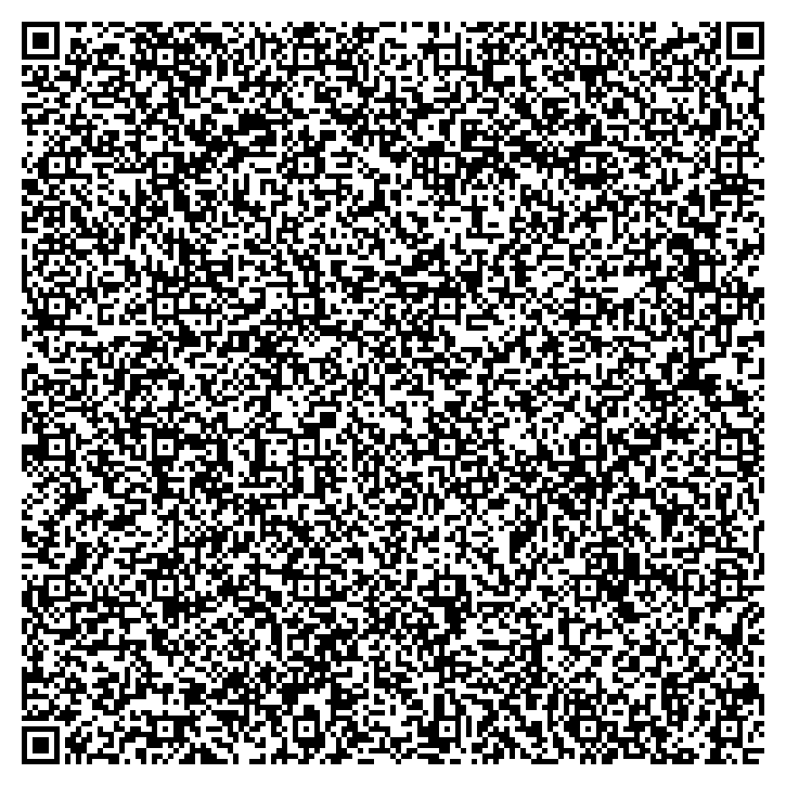

# This QR code is a language model



Live page: **https://q.shayon.work**

I wanted to know how good a language model can be if the whole thing, program
and weights, has to fit inside one link. The smallest fits in a QR code: scan
it and a small neural network runs in your browser and makes up names of AI
models, like `glm-3.5-12b-instruct` or `llama3.3-maxn`. Longer links hold story
models trained on TinyStories. Nothing is downloaded. The page at
`q.shayon.work` is a small loader (`site/index.html`): it reads the part of the
link after `#`, runs it as a program, and that program unpacks its weights from
the rest of the link. The `#` part never leaves your browser. A phone camera
will not run code straight from a QR code, which is why the link points at a
loader page.

I'm looking for my next role, Berlin or remote: hi@shayon.work

## The two link formats

The loader tells them apart by the first three characters after `#`.

**QR code: `HTTPS://Q.SHAYON.WORK/#NNN<program><digits>`.** `NNN` is the
program length, then raw JavaScript, then one long decimal number that holds
every weight. QR codes store digits and upper-case letters most compactly
(numeric mode packs 3 digits into 10 bits), so the host is upper case and the
weights are digits. The current code has 444 characters of program and 2,959
digits. The program defines `g()`; the loader calls it and shows the result.

```js
const f = decodeURIComponent(location.hash.slice(1)), n = +f.slice(0, 3);
window.d = f.slice(3 + n);
(0, eval)(f.slice(3, 3 + n));                      // non-strict: it uses with(Math)
(window.onclick = () => { document.body.textContent = g(); })();
```

**Longer links: `https://q.shayon.work/#<base64url program>.<weights>`.** Split
at the first dot, base64url-decode the program and run it with `d` set to
everything after the dot. The program reads its own weights (the story
transformers use 4-bit weights with per-row scales) and writes its own output.

## The models

| Link | Model | Weights | URL characters | Score (bits/char) |
|---|---|---:|---:|---|
| QR code (version 30, 137 modules) | Names: MLP, last 3 characters plus name length, 29 tanh units | 1,984 | 3,429 | 2.313 on 151 held-out names |
| QR-sized | Stories: MLP, last 3 characters, 32 tanh units | 1,895 | 3,352 | 2.480 (reduced alphabet) |
| 64 KB | Stories: transformer, 2 layers, width 60, 4-bit | 90,420 | 64,529 | 1.610 |
| 1 MB | Stories: transformer, 4 layers, width 176, 4-bit | 1,498,640 | 1,010,424 | 1.104 |

Scores come from running the exact exported program, not the training model.
Lower is better. Story scores are on a fixed 500,000-character slice of the
TinyStories validation set. The QR story model uses a smaller alphabet (lower
case, basic punctuation), so its score is not comparable with the two bigger
ones. The names split was also used to pick the model, so 2.313 is a
validation score, not a clean test score.

## Check and reproduce

You need [uv](https://docs.astral.sh/uv/) and Node 22 or newer. Run from the
repo root. Set `OMP_NUM_THREADS=2` for anything that uses torch if you share
the machine.

```bash
uv sync
uv run python tools/check.py               # static + Node + Firefox and Chromium, about a minute
uv run python tools/check.py --no-browser  # skip the browsers
```

`tools/check.py` checks that the served payloads match `out/`, that the QR
images decode to exactly the names link, the response headers, and the
loader's fallback decompressor. Then `tools/browser_test.py` runs each link in
the loader and walks through the launch page. The browser part uses
`uv run --with playwright` and needs its browsers
(`uv run --with playwright playwright install firefox chromium`).

Without training, on a laptop CPU:

```bash
# Names: re-export from the checkpoint (byte-identical), then check every probability in Node.
uv run python names/qrtf.py export names/qrtf_mlp_best.pt --output /tmp/names   # about 4 minutes
cmp /tmp/names.url.txt names/payload_url_mlp_qrtf.txt
node names/verify_qrtf.js names/payload_url_mlp_qrtf.txt /tmp/names.fixture.json 200

# Fold in the 0.8 sampling temperature; rewrites out/qr_names_url.txt and the QR images.
uv run python tools/make_qr.py

# Story data: the fixed held-out benchmark (plus, without --heldout-only, 40 MiB of training text).
uv run python stories/get_data.py --heldout-only --vocab-from out/t64kfix_url.txt
# The QR story model also reads data/qrstory_train_raw.txt, see the top of stories/qrstory.py.

# QR-sized story model: re-export (byte-identical), checked in Node.
uv run python stories/qrstory.py export out/qrstory_L31_h32_k3_e6.pt --temp 0.7 --publish
node stories/verify_qrstory.js out/qrstory_url.txt

# Story transformers: score the links in Node and in Python on the first held-out characters.
node stories/verify_stories.js out/t64kfix_url.txt 2000 1 0
node stories/verify_stories.js out/big2_url.txt 300 1 0
uv run python stories/score_story.py out/t64kfix_url.txt --chars 2000
uv run python stories/test_stories.py
```

Training, if you want it (I have not rerun these after the cleanup):

- Names: `names/teacher.py` makes the GRU teacher, its 19k samples and the
  distilled starting point. The QR model is then one run of under 15 minutes,
  with the exact command in `docs/RESULTS_qrtf.md`.
- QR story model: `uv run python stories/qrstory.py train --e 6 --h 32 --k 3 --levels 31 --tag L31_h32_k3_e6`.
- 64 KB story model, two runs of about 8 and 16 minutes, then export:

  ```bash
  uv run python stories/stories.py train qat_baseline d=60 L=2 H=4 ctx=128 bits=4 lr=0.01 qat=0.3 scale=tensor ste=identity steps=100000 minutes=8 eval_seconds=120 dev_chars=10000 diag_chars=10000
  uv run python stories/stories.py train t64kfix d=60 L=2 H=4 ctx=128 bits=4 bs=32 lr=0.002 qat=1 scale=row ste=clipped qclip=2.5 warmup=50 min_lr=0.01 seed=1 steps=100000 minutes=12 eval_seconds=150 dev_chars=20000 diag_chars=10000 init=out/qat_baseline.preqat.pt
  uv run python stories/stories.py export t64kfix
  ```

- 1 MB story model: about 3 hours on two ARM cores; its settings are the `cfg`
  block of `out/big2_meta.json`, passed as `key=value` to
  `stories/stories.py train big2`.

The two story transformer checkpoints are not in the repo, only their links.

## Layout

```
site/     the live site, served as-is by Cloudflare Pages (no build step)
          index.html is the loader, home/ the launch page, data/payloads/ the four links
names/    the names model in the QR code: name list, training, export, checkpoints,
          the readable program and its Node verifier, the results table
stories/  story models: transformer, QR-sized MLP, data download, JS runtime, verifiers
out/      the four published links, their measurements (*_meta.json), the QR story checkpoint
tools/    checks, the QR image builder, the shared host prefix (host.json)
docs/     findings.md (what was tried) and RESULTS_qrtf.md (the QR transformer record)
```

`names/chatnames.txt` (1,215 chat model names) was cleaned from LiteLLM's
`model_prices_and_context_window.json` with `names/clean2.py`.

## What I found

At QR size a plain MLP beat every transformer I tried. The best attention model
that fits the same QR version scores 2.417 against 2.313 for the MLP; its
program is about 290 characters longer, which leaves less room for weights.
Recurrent nets, a longer window and word pieces were also worse. What helped
most was cleaning the name list down to chat models, then coarser weights (31
levels instead of 61, with learned scales), which made room for 29 hidden units
instead of 24. Distilling from a larger teacher gave a small gain. The table,
and the caveat that these QR-size comparisons were selected on the same split
they are scored on, are in [`docs/findings.md`](docs/findings.md).

## How this was built

This was built with Fable 5.2 orchestrating other Claudes and Codex and Grok,
with frequent prompting and steering for "taste".

## Credits

- The names list is derived from LiteLLM's `model_prices_and_context_window.json`
  ([github.com/BerriAI/litellm](https://github.com/BerriAI/litellm), MIT licence).
- The story models are trained on TinyStories (Ronen Eldan and Yuanzhi Li, 2023,
  "TinyStories: How Small Can Language Models Be and Still Speak Coherent English?").
- The site uses the Space Grotesk font (SIL Open Font License).

## Licence

MIT, see [`LICENSE`](LICENSE).
